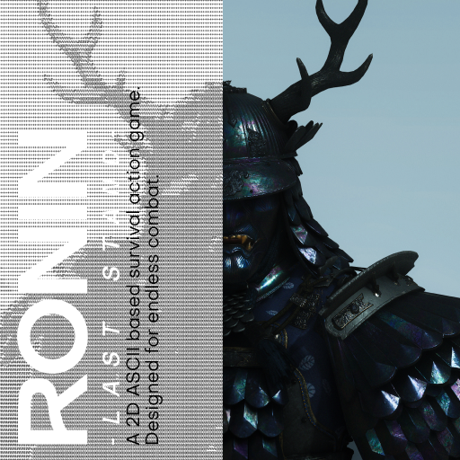
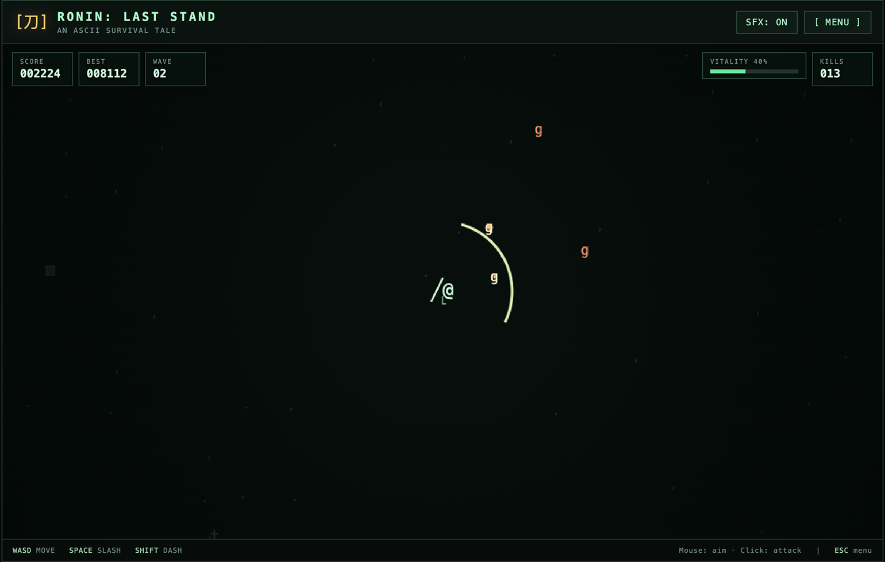

  

  <strong>A 2D ASCII-based survival action game.</strong> 
  Designed for endless combat.

  

  <strong>A THDOO_ ORIGINAL</strong> 
  Independent game development project · 2026

---

## About

**RONIN: LAST STAND** is a browser-playable, 2D ASCII-inspired survival action game. Take control of a lone samurai, move freely around the arena, fight enemy waves with your katana, dodge incoming attacks and see how long you can survive.

The game focuses on an endless survival loop: defeat enemies, clear waves, earn score and face increasingly challenging encounters.

## Gameplay

  

## Features

- Free-roaming arena with a scrolling camera
- Katana slash combat
- Dash movement for dodging
- Multiple enemy types
- Enemy AI that pursues and attacks the player
- Endless wave progression
- Boss encounters every fifth wave
- Health, score, kills and high-score HUD
- Combo scoring and wave-clear rewards
- Menu with Continue and New Game options
- Music and sound-effect controls
- Local browser save data for high score and interrupted runs

## Enemies

| Character | Enemy | Description |
|:--:|---|---|
| `g` | Grunt | Basic enemy |
| `r` | Runner | Faster enemy |
| `B` | Brute | Heavy enemy with more health |
| `K` | Boss | Powerful encounter on every fifth wave |

## Controls

| Input | Action |
|---|---|
| `W A S D` | Move |
| Arrow keys | Move |
| `SPACE` | Katana slash |
| `SHIFT` | Dash |
| `ESC` | Open / close menu |
| Mouse movement | Aim |
| Left click | Attack |

Touch controls are available on supported touch devices.

## How to Play

### Play locally

1. Download `ronin_last_stand.html` from the latest release.
2. Open the file in a modern browser.
3. Start a new game and enter the battlefield.

No game engine or separate installation is required for the HTML version.

### Download

**[Download the latest version](https://github.com/shebron25/RONIN-LAST-STAND/releases/latest)**

The release page is the recommended place to publish versioned game downloads.

## Built With

- **HTML5** — page and game structure
- **CSS3** — interface styling
- **JavaScript** — gameplay logic
- **Canvas API** — game rendering
- **Web Audio API** — synthesized audio
- **LocalStorage** — local save data and preferences

## Development Roadmap

Planned ideas for future development:

- [ ] Additional environments
- [ ] More weapons and abilities
- [ ] Character progression and upgrades
- [ ] Expanded boss mechanics
- [ ] Power-ups and collectibles
- [ ] Improved animations and effects
- [ ] Online leaderboard
- [ ] Installable PWA version

## Project Status

RONIN: LAST STAND is currently a playable browser-game prototype. Features listed above describe the current project; roadmap items are future development ideas.

## Developer

**THDOO_**  
Designed & developed by [@shebron25](https://github.com/shebron25).

---

  <strong>RONIN: LAST STAND</strong> 
  <em>One sword. Endless waves. One last stand.</em>  
  [A THDOO_ Original](https://github.com/shebron25) · 2026

